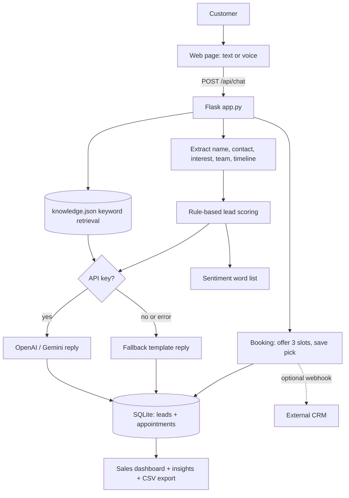
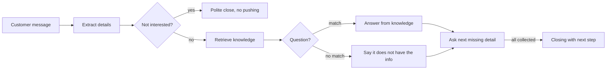

# FortiSales AI — Work Chart

## 1. Development workflow
1. Inspected the environment (Python 3.12, Flask and requests available, **no internet**).
2. Repository discovery: not possible offline, so the app was built from scratch (see README).
3. Wrote the knowledge base, then `app.py` (retrieval → extraction → scoring → replies → storage).
4. Built the chat/voice page and dashboard.
5. Ran scenario tests, fixed two bugs found (summary crash on empty reasons; product names like "FortiDesk" not counted as interest).
6. Tuned scoring after the WARM test came out HOT (contact details now worth only +5).
7. Wrote the two documentation files.

## 2. System architecture

## 3. Main components
| Component | Where | Job |
|---|---|---|
| Chat page | `templates/index.html` | Messages, mic, speech output, live lead panel |
| Retrieval | `retrieve()` in `app.py` | Keyword overlap with `knowledge.json` (min score 2) |
| Extraction | `extract()` | Regex for name, email/phone, product, team size, timeline |
| Scoring | `RULES`, `score_lead()` | Point rules, reasons list |
| Reply engine | `fallback_reply()`, `call_llm()` | Template replies, or LLM with retrieved facts only |
| Storage | `save_lead()` | One upsert per message into SQLite |
| Dashboard | `templates/dashboard.html` | Counts, filters, details |

## 4. End-to-end customer journey
Open chat → greeting (says it is an AI) → customer states a need → agent recommends from knowledge → follow-up questions (team size, timeline) → name and contact → category and closing message → lead appears on the dashboard with summary and transcript.

## 5. Lead qualification workflow
All customer messages are combined; each rule fires once.

| Signal | Points |
|---|---|
| Buy / sign up / quote | +30 |
| Demo or trial | +20 |
| Near-term timeline | +20 |
| Clear need · budget mentioned | +15 each |
| Product identified · team size · pricing question | +10 each |
| Longer-term timeline · comparing options · contact shared | +5 each |
| Not interested / just browsing | −40 |
| Budget blocker | −25 |
| Wants to postpone | −15 |

Score is capped to 0–100: **HOT ≥ 60**, **WARM 25–59**, **COLD < 25**. The matched rules are stored and shown as the reason.

## 6. AI conversation workflow

Missing details are asked in this order: interest, team size, timeline, name, contact. Each is asked at most twice. If the customer asks for a demo, trial or purchase, name and contact come first.

## 7. 90-minute plan (planned allocation)
Actual wall-clock time was not measured; this is the planned split and what it covered.

| Block | Planned | Result |
|---|---|---|
| Repository search | 0–10 | Skipped: offline, built from scratch |
| Setup and inspection | 10–20 | Done |
| Conversation + retrieval | 20–40 | Done |
| Scoring + storage | 40–55 | Done |
| Voice + dashboard | 55–70 | Done (voice untested in a real browser) |
| Testing | 70–80 | Done (see section 10) |
| Debug + docs | 80–90 | Done |

## 8. Implemented features
Sentiment analysis (rule-based), appointment booking with conflict protection, CSV export and optional CRM webhook, dashboard business insights, greeting and AI disclosure, contextual follow-ups, knowledge retrieval, honest unknown answers, HOT/WARM/COLD scoring with reasons, SQLite storage, conversation summary, live lead panel, dashboard with filters and transcripts, mic input with permission-error handling, spoken replies, text fallback, labelled fallback mode, OpenAI and Gemini support.

## 9. Not implemented
GitHub search, fork and push (no internet or GitHub access); telephony; real-time streaming voice; multilingual scoring, sentiment and fallback replies; dashboard login; real calendar sync and invites; native CRM connectors; embeddings; memory across sessions; persistent chat sessions across restarts.

## 10. Testing performed
Run in the build sandbox with Flask's test client (temporary database) and a short live server run:

| # | Check | Result |
|---|---|---|
| 1 | App starts; `/`, `/dashboard`, `/api/status` return 200 on a real server | Pass |
| 2 | Conversation starts and AI replies | Pass |
| 3 | Follow-up questions asked (interest, team size, name, contact) | Pass |
| 4 | Answers from knowledge (security, Slack integration, product info) | Pass |
| 5 | Unknown question ("mobile app for Android") answered honestly | Pass |
| 6 | HOT scenario → HOT 95 | Pass |
| 7 | WARM scenario → WARM 55 (first run gave HOT 65, scoring was corrected) | Pass |
| 8 | COLD scenario → COLD 0 | Pass |
| 9 | Lead saved to SQLite, upserted per message | Pass |
| 10 | Dashboard shows saved lead, category filter loads | Pass |
| 11 | Summary generated (template version) | Pass |
| 12 | Text chat works with no microphone; empty message rejected (400) | Pass |
| 13 | Page JavaScript parses (`node --check`) | Pass |
| 14 | OpenAI path with a **mocked** HTTP call; API failure falls back and labels the mode | Pass (mock only) |
| 17 | Sentiment: negative, positive and negated phrases ("not bad") classified; empathy line added for negative | Pass |
| 18 | Booking: slots offered, picked by number or weekday, saved; a taken slot is skipped for the next customer; repeat booking refused | Pass |
| 19 | Dashboard insights, upcoming demos list and CSV export load | Pass |
| 20 | Old database upgraded automatically (new columns added) | Pass |
| 21 | CRM webhook fires on booking (**mocked** HTTP call, no real CRM) | Pass (mock only) |
| 15 | Real OpenAI / Gemini calls | **Not tested** (no key, no network) |
| 16 | Voice input and speech output in a real browser | **Not tested** (no browser or microphone in the sandbox) |
